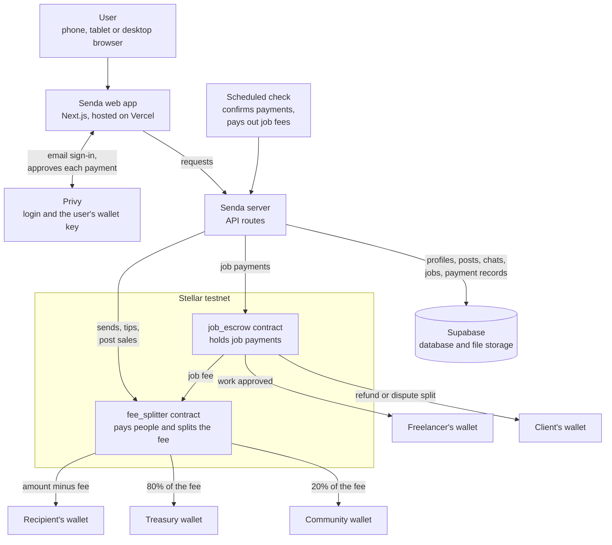
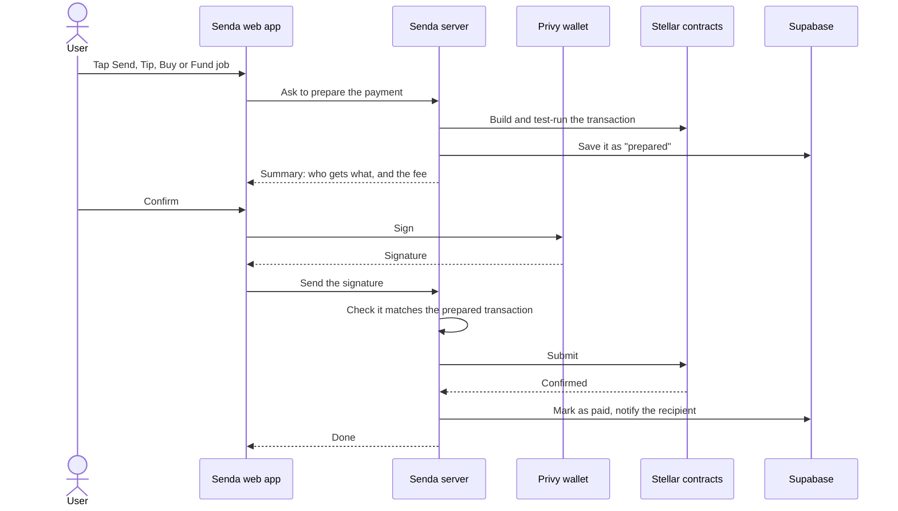

# Senda

**Send money. Share moments.**

Senda is a social wallet. You sign in with your email, follow people, post, and pay: send or request money by username, tip a post, sell a paid post, or hire someone with the payment held safely until the work is approved.

It runs on the Stellar test network today. Balances are free test money with no real value.

- [How Senda works](#how-senda-works)
- [Architecture](#architecture)
- [Where the money goes](#where-the-money-goes)
- [Smart contracts](#smart-contracts)
- [Wallets](#wallets)
- [Deployment record](#deployment-record)
- [Run it yourself](#run-it-yourself)
- [Project layout](#project-layout)
- [Status and roadmap](#status-and-roadmap)
- [Team](#team)

## How Senda works

| You do this | What happens |
|---|---|
| Sign in with your email | A wallet is created for you. No passwords or seed words. Only you can approve a payment from it. |
| Pick a username | Friends pay `@you` instead of a long wallet address. |
| Send or request money | Pay anyone by username, or ask for money inside a chat. The other person taps **Pay** and the request turns into **Paid** once the money lands. |
| Swap | Change XLM to USDC or back inside your own wallet at the live price. You see the exact amounts first, and Senda takes no fee. |
| Tip a post | The creator is paid straight away. |
| Sell a post | Mark a post as Premium and set your own price in USDC. The post stays visible to everyone; buyers become owners. Bidding is planned for later. |
| Hire someone | You lock the payment before work starts. It is released when you approve the work, refunded if the deadline passes with nothing delivered, or split by a mediator if you disagree. |

Every payment follows the same steps:

1. The server builds the exact transaction and shows you a plain summary: who gets what, and the fee.
2. Your wallet signs it. The server never holds your key and cannot sign for you.
3. The server checks the signature matches the transaction it built, then sends it to the network.
4. Nothing in the app is marked as paid until the network confirms it.

Senda never holds user money. Payments go wallet to wallet, and job payments sit in a public contract that Senda cannot withdraw from.

## Architecture

How the parts fit together. People only ever touch the web app; everything else works behind it.



What each part does:

| Part | Job |
|---|---|
| Web app | The screens: feed, chats, wallet, jobs, settings. |
| Privy | Email sign-in and the user's wallet. Only the user can approve a payment; Senda never sees the key. |
| Senda server | Checks who is asking, builds each transaction, verifies the signature, sends it to Stellar once signed, and records the result. |
| Supabase | Stores profiles, posts, messages, jobs and payment records, plus uploaded photos. |
| `fee_splitter` | Pays the recipient and splits Senda's fee between treasury and community in one step. |
| `job_escrow` | Holds a job payment until the work is approved, refunded or settled. |
| Scheduled check | Re-checks pending payments and pays out collected job fees. |

A payment, step by step:



## Where the money goes

Senda takes a small fee, and the fee is split on-chain by Senda's own contract:

| Payment | Fee | Recipient gets |
|---|---|---|
| Send, or pay a chat request | 0.5% | 99.5% |
| Tip | 2.5% | 97.5% |
| Paid post | 2.5% | 97.5% |
| Job payout | 2.5% | 97.5% |

Every fee is split the same way: **80% to the treasury wallet, 20% to the community wallet.**

Example, a 10 USDC tip:

```
payer sends 10.00 USDC
   ├─ 9.75  → creator
   ├─ 0.20  → treasury   (80% of the 0.25 fee)
   └─ 0.05  → community  (20% of the 0.25 fee)
all in one transaction: either every part happens, or none does
```

Job fees take one extra step: the job escrow sends its fee to the fee contract, and the fee contract pays it out to the same two wallets. Anyone can trigger that payout; Senda's server does it automatically.

The fee rates and the two recipient wallets are stored in the contract, so anyone can read them and no payment request can change them.

## Smart contracts

Written in Rust for Soroban (Stellar's smart contract platform). Source is in [`contracts/`](contracts/).

### `fee_splitter` (pays people and splits the fee)

`CAYT5ITMELZZRGSI3VXCLZYM4XUYLCVRGBIWNJN4POQFJXBCUMA4PG3J` · [view on explorer](https://stellar.expert/explorer/testnet/contract/CAYT5ITMELZZRGSI3VXCLZYM4XUYLCVRGBIWNJN4POQFJXBCUMA4PG3J)

- `pay(from, to, token, amount, kind)` sends the recipient their share and the fee to the treasury and community wallets, in one step. Used for sends, chat requests, tips and paid posts.
- `distribute(token)` pays out job fees that the escrow sent to the contract. Anyone can call it.
- Rules it enforces: exactly `amount` leaves the payer, the fee is capped at 10%, shares always total 100%, only USDC and XLM are accepted, and the contract never keeps a payment.
- The admin can change the fee rates (within the cap) and the recipient wallets, and can pause `pay`. The admin cannot touch anyone's payment. Upgrades wait 7 days.

### `job_escrow` (holds job payments)

`CAPHY7BPH7T374NWFHZSSYEU24URTGREWW7XNSPENKALSPUJFIFVDUUN` · [view on explorer](https://stellar.expert/explorer/testnet/contract/CAPHY7BPH7T374NWFHZSSYEU24URTGREWW7XNSPENKALSPUJFIFVDUUN)

- The client locks the payment. The freelancer submits proof of work. The client approves and the freelancer is paid, minus the fee.
- If the client goes quiet after proof is submitted, the freelancer can claim after the review period (7 days).
- If no work arrives by the deadline, anyone can trigger the refund to the client.
- In a dispute, a mediator can only split the money between the client and the freelancer. Nobody at Senda can send it anywhere else.
- Pausing only stops new jobs. Money already locked can always be released, refunded or settled.

### `usdc_earn_vault` (savings, not live)

`CCHVH2MXKFSKC5WCWMGL3GGMPKA37UZTCJTUSLQMJDOKDFD6AOXURV67` · [view on explorer](https://stellar.expert/explorer/testnet/contract/CCHVH2MXKFSKC5WCWMGL3GGMPKA37UZTCJTUSLQMJDOKDFD6AOXURV67)

An experimental savings vault. It is deployed on testnet but switched off in the app, has not been audited, and has never held a deposit.

### Tests

45 contract tests, including property tests that check money is never created or lost: `fee_splitter` 13, `job_escrow` 23, `usdc_earn_vault` 7, shared math 2. Run them with `pnpm contracts:test`.

`pnpm test:live` runs every payment and job step on testnet using the same server code the app uses: send, tip, buying a Premium post, and a job that is funded, delivered, revised, approved, refunded, cancelled, settled by agreement and ruled on by the mediator, in both XLM and USDC. The latest run is in [`ops/deployer/manifests/live-check-2026-11-14.txt`](ops/deployer/manifests/live-check-2026-11-14.txt).

## Wallets

All on Stellar testnet. Click an address to see its full history.

| Wallet | Address | What it does |
|---|---|---|
| Deployer | [`GCWPFDF44ISIKDKC6I4KCV6LP3BHHG55JWGEZJE4NTI4O6Q4ZPGF66SX`](https://stellar.expert/explorer/testnet/account/GCWPFDF44ISIKDKC6I4KCV6LP3BHHG55JWGEZJE4NTI4O6Q4ZPGF66SX) | Deployed the contracts. Admin of all three; guardian and mediator of the job escrow. |
| Treasury | [`GAJFQEBCRMK6REOVYEJRJKFFX3E5AONAO4M5HPL3SVPVQ7HLG5FYYNCO`](https://stellar.expert/explorer/testnet/account/GAJFQEBCRMK6REOVYEJRJKFFX3E5AONAO4M5HPL3SVPVQ7HLG5FYYNCO) | Receives 80% of every fee. Also hands out free test money to new users. |
| Community | [`GAASQI4VUVKFQTV3Y2T7FX6LSRL4OXKKDLWKALJXPRUTTXVPFB2XLRF5`](https://stellar.expert/explorer/testnet/account/GAASQI4VUVKFQTV3Y2T7FX6LSRL4OXKKDLWKALJXPRUTTXVPFB2XLRF5) | Receives 20% of every fee. |

Private keys are never stored in this repository.

## Deployment record

Every transaction below is public. Open one at `https://stellar.expert/explorer/testnet/tx/<hash>`.

**Contracts**

| Date | What | Transaction |
|---|---|---|
| 2026-10-24 | `job_escrow` code uploaded | `aa59a83c4555f1ae33437aa039fa7197510940293a5c2625419d47985eb00559` |
| 2026-10-24 | `job_escrow` deployed | `47070ae49c87b73b00c2c7d551a97e01e0a1f8e581cf47874565b8379246bb18` |
| 2026-10-24 | `usdc_earn_vault` code uploaded | `571a358c05f25cf634514492c4d53d6666e29707dc207518150c1be7178e7e14` |
| 2026-10-24 | `usdc_earn_vault` deployed | `f3b3074784502955a79a9e703a7624f8ab9441f977b81b44f6abc74c5bbd2bcd` |
| 2026-11-14 | `fee_splitter` code uploaded | `2788c098801f0d4f1ed73bef36890d92da9292cb860750510c3d15230934f21d` |
| 2026-11-14 | `fee_splitter` deployed (treasury 80%, community 20%) | `175a90c69a595f9658802f73439d5022a862f0d95f5abd3275f1f55cc6aa2d16` |
| 2026-11-14 | `job_escrow` fees pointed at `fee_splitter` | `4fabc0b53358061033d8288f139f4b8a00162d186242fd16f0f3045f7ff247a0` |

**Wallet setup**

| Date | What | Transaction |
|---|---|---|
| 2026-10-25 | Treasury wallet created and funded | `a60f69f92a20fd7a776be9743ea6909102e99ddfaf54a30eb533c999ce757d7a` |
| 2026-10-25 | Treasury topped up with test USDC | `6ce70a49c26c6122100198af2c67b3367f5cd54f922ae007f7dbf936a4079d4c` |
| 2026-10-25 | Community wallet created and funded | `de2d8e004809ecde6a1c916898bbce7c2c41376b31e269d555b17f07996dd6c0` |

**Live checks on testnet**

| What was tested | Result | Transaction |
|---|---|---|
| Job: lock 10 XLM | Locked in the escrow | `6510c740c9bac3a22ddbf8221aae8f29056705d7d1f6dc4fbe0375547c9b4058` |
| Job: freelancer submits proof | Recorded | `7ef50de06e0653f0a7200652441bef1086f9d737ec8f18fb09e5e658753bb668` |
| Job: client approves | Freelancer got 9.75, fee 0.25 | `17978e26e5cbc4a3e9e5c0cf30cde68f20b90b801d5571d41335d6b9eb6d6cd2` |
| Tip of 10 XLM through `fee_splitter` | Creator 9.75, treasury 0.20, community 0.05 | `cf5339896d6eeff49eb3b670fc38dace39b2446964fe1e0ae6b4250688ff79d5` |
| Send of 0.10 USDC through `fee_splitter` | Recipient 0.0995, treasury 0.0004, community 0.0001 | `06594311f06459b07cd53292ee06c429530565fb506c073bb723f49bfbc43327` |
| `distribute` of 1 XLM, called by an unrelated wallet | Treasury 0.80, community 0.20 | `6d049b23d01647c2d660e5552604b1da5decc4c7e4335eaf6b211684582d52c9` |

The machine-readable records, including code hashes, are in [`ops/deployer/manifests/`](ops/deployer/manifests/).

## Run it yourself

You need Node 22, pnpm, a Supabase project and a Privy app. The step-by-step guide is [`START_HERE.md`](START_HERE.md).

```bash
pnpm install
cp .env.example .env.local     # then fill in Supabase and Privy keys
pnpm dev                       # http://localhost:3000
```

In Supabase, run `supabase/RUN_THIS_IN_SUPABASE.sql` once in the SQL Editor. The contract addresses above are already in `.env.example`.

Checks:

```bash
pnpm typecheck && pnpm test    # app and database tests
pnpm contracts:test            # contract tests (needs Rust)
pnpm test:live                 # real transactions on testnet (free test money)
pnpm test:e2e                  # browser tests
```

More detail: [`docs/ENV_SETUP.md`](docs/ENV_SETUP.md) for every setting, [`docs/SECURITY.md`](docs/SECURITY.md) for the security model, [`ops/deployer/README.md`](ops/deployer/README.md) for deploying contracts.

## Project layout

```
src/app          pages and API routes
src/lib/server   sign-in checks, payments, fees, job escrow, faucet (server only)
src/lib/stellar  amounts, network settings, transaction building
supabase/        database tables, functions and access rules
contracts/       fee_splitter, job_escrow, usdc_earn_vault
ops/deployer/    deploy and verify scripts, deployment records
tests/, e2e/     app, database and browser tests
```

Built with Next.js, Supabase, Privy and Stellar. Hosted on Vercel.

## Status and roadmap

| Stage | What |
|---|---|
| Done | Wallet, feed, chat, tips, paid posts, job payments, fee contract |
| **Now** | **Testnet preview with free test money** |
| Next | Independent security and legal review, then real payments step by step |
| Later | Mobile app |
| Later | Bidding on Premium posts |

Not ready for real money yet: the contracts have not had an independent audit, and the contract admin is a single key that should become a multi-signature wallet first. See the "Known gaps" list in [`docs/SECURITY.md`](docs/SECURITY.md).

## Team

- **Miles Kenneth Napilan**, Founder and Developer
- **Alicia Amor Cerrudo**, Co-founder and Quality Analyst
- **RyanChris Ariego**, Co-founder

Part of the Web3 Iloilo community.
